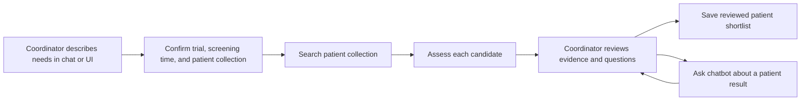
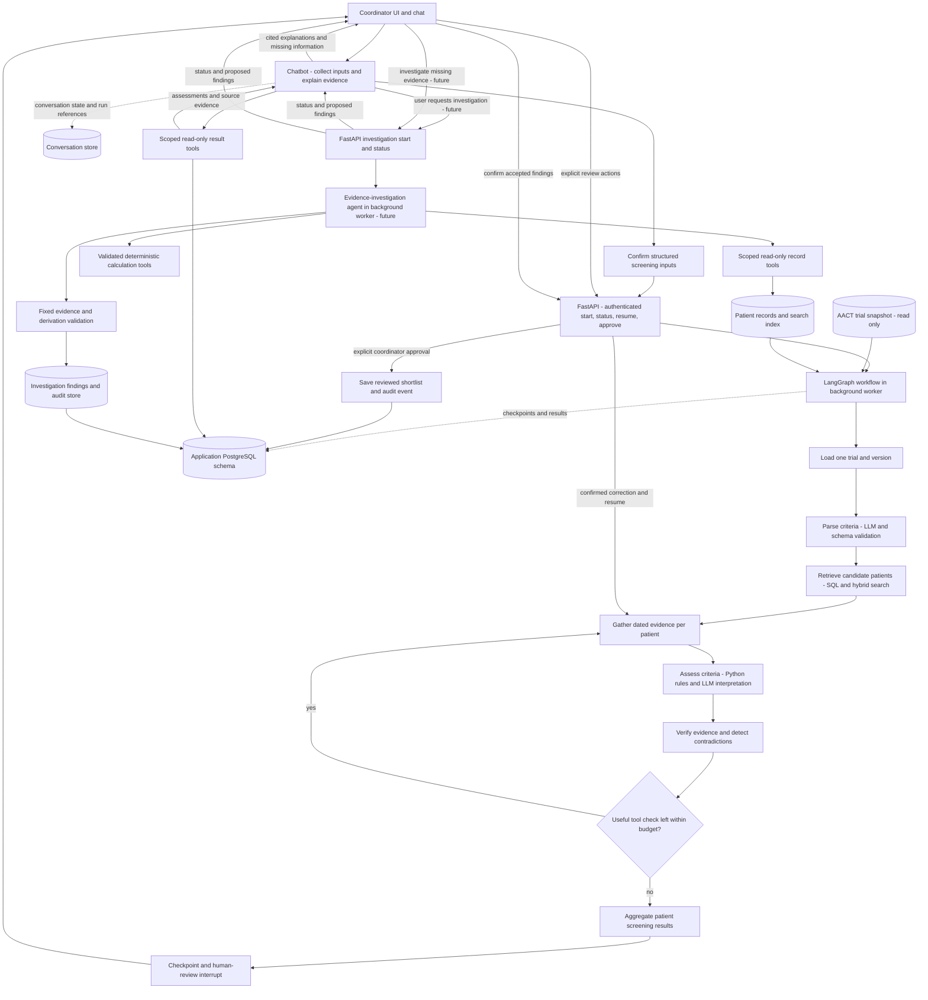
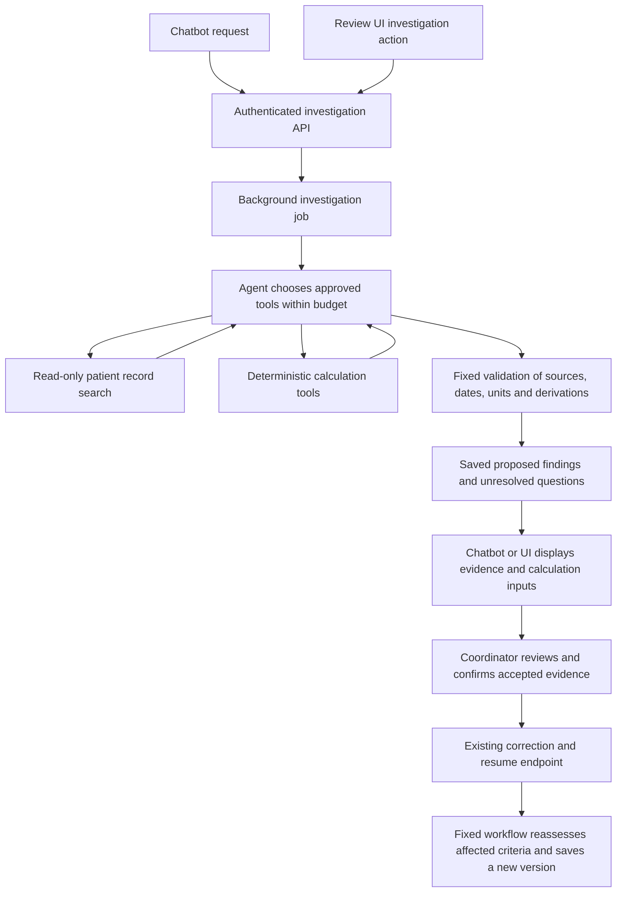

# Starter HLD — Trial-to-Patient Screening

**Proposed design, not implemented screening functionality.** Class 1 implements only the one-node API smoke test.

## User Process

## System Design

**Why one graph:** explicit control flow, shared state, testable nodes, and a review pause. Later parallelize independent patient checks; do not add autonomous agents just to increase their count. UI actions are separate start/resume/approve endpoints, not an unbounded loop that creates new jobs.

The diagram's investigation branch is a future extension. The fixed screening workflow remains the main orchestrator; the investigation agent runs as a separate, bounded backend workflow invoked on demand. It shares the application's access controls and versioned evidence services. Chatbot and review UI use the same backend capability.

## Responsibilities

| Part | Concrete behavior |
|---|---|
| Chatbot | Confirm trial, assessment time, collection, and mode; use validated API tools to start/status jobs; retrieve saved per-patient evidence for cited explanations. Propose corrections for coordinator confirmation. |
| API boundary | Authenticate and scope access for every tool/action. Keep start, status, confirmed correction/resume, and explicit approval distinct; validate payloads and run ownership. |
| Trial loader | Fetch one `nct_id` and frozen criteria; record snapshot. Block inactive trials in live-recruitment mode. |
| Criteria parser | Split inclusion/exclusion into atomic rules; preserve quotes, Boolean groups, units, time windows. Flag ambiguity. |
| Patient retriever | Search the **patient index**, not trial index. Return candidate IDs/scores/evidence. Retain unknowns; exclude only verified contradictions with mandatory rules. |
| Evidence gathering | Scoped read-only tools fetch patient facts/notes with IDs and dates. Preserve contradictory assertions. |
| Assessment | Python checks numbers/dates/Boolean rules; LLM interprets narratives with structured output. Missing/conflicting facts stay unresolved. |
| Verification | Quotes must exist, belong to the patient, and support the claim. Check units/time windows; never silently resolve medical contradictions. |
| Aggregation | Verified failed mandatory inclusion or applicable exclusion → screening failure. Otherwise unresolved criteria → needs review. Otherwise potential candidate, never enrollment approval. |
| Review/persistence | Checkpoint by screening run and patient; interrupt for review. Save corrections, rerun affected checks, and persist output/audit idempotently. |
| Investigation agent (future) | On a user request, choose approved record searches and calculations for one patient/run. Return proposed findings, sources, unresolved questions, and tool-use history for validation and review. |
| Investigation API/worker (future) | Validate scope and source versions, create a bounded background job, expose status/findings to chat and UI, and persist findings separately from confirmed screening evidence. |

Separate **evidence quality** (`supported`, `missing`, `conflicting`) from **condition applicability** (`true`, `false`, `unknown`) and **screening outcome** (`pass`, `fail`, `unknown`, `requires_review`). An applicable exclusion fails screening; a satisfied inclusion passes that criterion. Apply polarity once. The current prototype's `met`/`not_met` values describe screening satisfaction, so an applicable exclusion returns `not_met`; translate these explicitly at the future API boundary rather than interpreting `met` as exclusion applicability.

## Chatbot Interaction

Conversation state holds `conversation_id`, authenticated user/organization, proposed screening inputs, confirmed `run_id`, selected `patient_id`, and pending questions. Screening state remains versioned separately; the chatbot references saved results rather than making chat history the assessment source of truth.

For example, a coordinator requests screening for a trial. The chatbot proposes the trial ID, assessment time, authorized collection, and mode for confirmation, then starts one job and reports its status. When asked why a patient needs review, it retrieves that patient's stored assessment and explains the unknown or conflicting criteria with trial quotes and dated evidence references. If evidence is absent, it says what is missing.

New facts supplied in chat are proposed corrections, not verified patient evidence. An authorized coordinator confirms them through the correction endpoint, which records provenance and reruns affected checks. Shortlist approval is a separate explicit action. The chatbot does not independently decide eligibility or approve reports.

The chatbot uses the existing backend API through validated tool calling. MCP is optional for exposing those capabilities to other assistants; it is not a deployment dependency.

## Future Extension: User-Directed Evidence Investigation

The chatbot is the conversational entry point; the agent executes in a backend worker alongside the fixed screening workflows. A review-screen action can invoke the same agent without going through a conversation. This is a proposed design, not implemented functionality, and remains outside the MVP.

For missing BMI, the agent searches for dated height and weight, checks whether an approved calculation is supported, and invokes a Python calculator. Findings label the result as derived and retain input values, units, dates, source IDs, and calculation method. Incompatible, conflicting, or missing measurements remain unresolved. The agent can explain a supported calculation before confirmation; applying it to screening results uses the existing human-review path. It cannot overwrite source records or approve a shortlist.

Proposed endpoints are `POST /screening-runs/{run_id}/investigations` and `GET /investigations/{investigation_id}`. The start payload identifies the patient, user question, assessment version, and requested missing concept where known. The server derives and verifies the authorized collection and assessment-time scope from the screening run. The response includes the job ID and status; completed findings include proposed evidence, source references, derivations, unresolved questions, and consumed budget. Confirmation uses the existing correction/resume operation rather than giving the agent a write or approval tool.

Investigation state includes `investigation_id`, authenticated user/organization, `run_id`, `patient_id`, `assessment_time`, assessment/evidence versions, requested concept/question, tool results, proposed findings, validation errors, budget usage, and status. Stored conversation state holds references to these records. Recheck access for each tool call and result lookup. Reject stale findings from automatic application; review them against the current assessment version first. Persist investigation findings and audit events without modifying confirmed patient evidence until the coordinator accepts them.

Use explicit per-investigation tool-call, round, time, and cost limits. Exhaustion returns partial findings and review questions. Reuse tested calculation and verification functions; the agent chooses tools while fixed code checks the outputs. Confirming evidence and approving a shortlist remain separate human actions. See the [PRD future-work section](../../docs/new_syllabus/prd.md#11-future-work-evidence-investigation-agent) for scope and evaluation requirements.

## State, Tools, and Limits

Minimum state: `run_id`, `nct_id`, `trial_version`, `assessment_time`, `candidate_ids`, per-patient evidence/results, `questions`, `tool_calls_used`, `review_status`, and errors. Never mix patient evidence in an unkeyed list.

Start with four read-only tools: `get_trial(nct_id)`, `search_patients(criteria)`, `get_patient_record(patient_id)`, `get_patient_observations(patient_id, concept, time_window)`. Parameterized queries only; the LLM gets no arbitrary SQL, shell, keys, or database-write permission.

For chat, add scoped `get_screening_status(run_id)` and `get_patient_assessment(run_id, patient_id)` tools. Job submission uses the confirmed-input API; correction/resume and approval use explicit authorized UI actions. Every lookup checks collection/run/patient access server-side. Record tool calls and result versions without copying restricted evidence into general logs.

Initial configurable limits: 20 candidates/run, 2 additional evidence rounds/patient, 1 retry for transient API errors. Exhausted checks return visible partial results and review questions, not invented answers. Checkpoint storage supports restarting workers. Disable external tracing for restricted data; the public demo accepts only approved synthetic inputs.

**Week 1 boundary:** explain this design. Retrieval, structured assessments, durable interrupts, authentication, and deployment come later. TREC patient-to-trial ranking scores do not establish trial-to-patient retrieval performance; plan a direction-appropriate evaluation in the data lesson.

References: `https://docs.langchain.com/oss/python/langgraph/overview`, `https://docs.langchain.com/oss/python/langgraph/interrupts`, `https://docs.langchain.com/oss/python/langgraph/persistence`.
