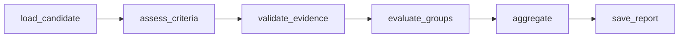

# Class 6: criterion assessment and screening reports

The reusable implementation is `src/clinical_trial_patient_matching/assessment.py`.
Class 5 selects candidates; Class 6 assesses each required trial predicate against
source-linked patient facts. Retrieval scores do not enter eligibility decisions.
The earlier MIMIC Claude experiment remains separate from this assessment engine.

## Result contract

`Criterion` preserves the exact frozen predicate, its inclusion/exclusion type,
reviewed executable `Rule` where available, and optional explicit applicability
rule. `Trial` requires unique criterion IDs and a frozen snapshot hash.
`Interpretation`, `CriterionResult` and `ScreeningReport` are strict Pydantic models.

| Field | Meaning |
|---|---|
| `status` | `met`, `not_met`, `unknown`, or justified `not_applicable` for the stated predicate |
| `evidence_state` | `supported`, `missing`, or `conflicting` |
| `verified` | A reviewed deterministic mapping produced a decisive result from usable facts |
| `processing_status` | `complete`, `failed`, or `unassessed`; distinct from patient eligibility |
| `citations`, `evidence_ids` | Exact source spans and fact IDs belonging to this patient and variant |
| `source_references` | Source record, dataset, version and hash for each cited fact |
| `follow_up` | A request addressing the unresolved predicate, including BMI/HbA1c source requests |
| Identity | Trial/profile versions, patient variant, assessment cutoff and time basis |

For exclusion predicates, **met means the exclusion is present**. The older
`criteria.evaluate_numeric` helper returns screening-oriented polarity and is
intentionally not used by this engine. Its existing behavior is unchanged.

Schema/citation validation does not establish clinical entailment. Narrative model
interpretations remain `verified=false`; a human verification mechanism is future
work. They cannot independently promote a patient to potential candidate or
create a verified eligibility conflict.

## Workflow and evidence rules



Recursive group predicates are evaluated during assessment; the group node checks
the resulting parent identities and completeness before aggregation. Apply
inclusion/exclusion polarity only to parent results. AND/OR use three-valued
logic; a decisive branch may establish a parent despite an unknown alternative.
No early stopping is used: every required criterion gets a result. The aggregator
also detects missing parent results and records explicit unassessed findings.

Numeric comparisons preserve strict/inclusive bounds and exact supplied units.
An unsupported unit, Boolean value, uncertainty, family fact, missing time, or
unreviewed mapping produces unknown. Clinical and availability times must both be
no later than a dated cutoff. Reviewed calendar-month windows are inclusive;
an unresolved boundary convention remains unknown. Without a stated measurement
window, select the latest usable observation without inventing a maximum age.
Preserve conflicting same-context values; no arbitrary precedence is assigned.

`duration_status` compares reviewed start/end intervals in calendar months or
days and requires explicit continuity when necessary. `count_events` deduplicates
source event IDs within a closed window and requires complete-history confirmation.
These helpers do not construct a verified history from prescriptions or billing
records. The supplied medication profiles lack that history, so their duration
rules remain unknown in deterministic mode.

An explicit reviewed applicability predicate must be false before a requirement
can become `not_applicable`. Its citations and skipped-branch justification are
saved. Unknown applicability stays unknown.

Narrative interpretation supplies one criterion and a bounded evidence bundle
(40 narrative facts / 60,000 serialized characters). Structured source rows are
not sent through this narrative path because they can contain future end dates.
Truncation forbids decisive narrative conclusions. Answers need exact citations;
invented/foreign IDs, unsupported quotes, and decisive use of conflicting evidence
are rejected. A successful first response is not retried. Failure permits one
repair, then saves `unknown` with `processing_status=failed`. The prompt version,
prompt hash, model/provider configuration, evidence bundle and attempts are saved.

Aggregation precedence:

1. Verified failed mandatory inclusion or verified met exclusion:
   `explicit_eligibility_conflict`.
2. Missing/unverified/unknown/failed results or incomplete profile processing:
   `needs_review`.
3. All applicable predicates pass, with justified nonapplicability:
   `potential_candidate`.

All reports require human review and do not authorize enrollment.

### Overall eligibility evidence score

Each report includes `eligibility_score` with a method version, value (0–100),
verified pass/failure counts, unresolved count, justified nonapplicable count,
applicable total, and assessment coverage. Every required parent criterion has
equal weight; child branches do not independently inflate the score.

`score = 100 × verified passing criteria / applicable required criteria`

A passing inclusion is `met`; a passing exclusion is `not_met`. Unknown, missing,
failed-processing and unverified narrative results remain in the denominator and
earn no points. Only verified, justified nonapplicable criteria are excluded.
If no applicable criteria remain, the score is null rather than 100. Coverage
reports the fraction with verified pass/fail decisions, distinguishing a lack of
evidence from documented failures. Saved scores are checked against the results
when loading a report; older reports gain a calculated score on load.

This is evidence completeness/satisfaction, not a calibrated probability of
eligibility. A 90/100 score with a verified mandatory failure remains
`explicit_eligibility_conflict`. There is no automatic score threshold for
acceptance, and unknown is not converted into a clinical failure. Markdown
reports, the comparison, and each heatmap patient row show the score; clicking a
cell also shows the counts and coverage.

## Generate the required examples

Existing Class 4 and Class 5 source preparation must have been run. The script
uses the November 2021 shared Synthea profile, the pinned original TREC profile,
and the separately labeled fictional conflict profile. It freezes the existing
local ClinicalTrials.gov snapshots and checks exact source wording before
activating the small author-checked numeric mappings. An unsupported trial or
changed phrase is not silently mapped.

```bash
pixi run assessment-cases
pixi run assessment-evaluate
```

Outputs under `data/class6/`:

| File | Purpose |
|---|---|
| `NCT*-trial.json` | Every frozen required predicate, including metadata age |
| `*-profile.json` | Exact input profiles; TREC age 24 is added from its literal source span |
| `reports/<report_key>.json` | Validated results, provenance, questions and aggregate |
| `*-rules-only.md` | Readable deterministic assessment tables |
| `*-rules-plus-replay.md` | Deterministic plus an explicit teaching interpretation |
| `manifest.json` | Trial versions, case/mode identities and report references |
| `evaluation.json`, `comparison.md` | Engineering comparisons and their limitations |

The default replay recognizes the exact three-day insulin interruption example.
It is not Claude and its score is not evidence of generalization. No external
model is called by the default commands. Optional public-case live interpretation:

```bash
pixi run python scripts/prepare_class6.py --model claude-haiku-4-5-20251001 \
  --output data/class6-live
pixi run python scripts/evaluate_class6.py --input data/class6-live
```

This is opt-in, uses the configured Anthropic account, and assesses individual
narrative predicates. It has not been run as part of the initial Class 6 work.
Replace the model ID if your configured account uses a different model.

Observed default outcomes:

| Case | Numeric/source result | Overall |
|---|---|---|
| Shared Synthea vs NCT03926806 | BMI 29.38 and HbA1c 5.84% meet the mapped requirements; other requirements unresolved | `needs_review` |
| Original TREC vs NCT04450407 | HbA1c 11.3% fails the inclusive 5.6–9.5% requirement; age 24 meets minimum 18 | `explicit_eligibility_conflict` |
| Fictional TREC conflict | Original 11.3% and invented 8.2% are both preserved; HbA1c unknown/conflicting | `needs_review` |

Synthea's computed age lacks a source availability timestamp, so it is unknown
under the strict retrospective cutoff policy rather than assumed available.

## Connect a Class 5 shortlist

```bash
pixi run assess-candidates \
  --trial data/class6/NCT03926806-trial.json \
  --shortlist data/class5/run/shortlist.json \
  --profiles-dir data/class5/profiles \
  --output data/class6/shortlist
```

Only `selected=true` entries are assessed. The frozen trial ID/hash must match
the retrieval query, patient IDs must match profiles, and the saved retrieval
assessment cutoff is retained. The CLI also accepts a single `--profile` with an
aware `--assessment-time`, or `--time-basis described_presentation` for the undated
TREC example. Deterministic assessment is the default; `--model` opts into the
narrative adapter. Custom datasets still require reviewed criterion mappings and
an adapter preserving their source and time semantics.

## Evaluation and review handoff

To explore the saved results as a standalone HTML heatmap:

```bash
pixi run assessment-heatmap
```

Open `data/class6/heatmap.html` in a browser. Rows are patient IDs with separate
variants; columns are required criteria. Met is green, not met red, unknown grey,
and not applicable violet. These are predicate colors: a green exclusion means
the exclusion is present, not that the patient qualifies. Click any criterion
header for its exact wording and trial link, or a cell for its explanation,
source quotes, verification status and follow-up. Patient-set, trial, mode and
patient-ID filters are available. The default view uses the 20 saved Class 5
shortlist reports when present; shared examples and replay modes remain separate.
The page embeds the results and needs no server, CDN or live model. Handle the
HTML like the source data because its evidence is embedded. The generator also
accepts `--input` and `--output` paths; generated pages stay in ignored `data/`.

`tests/fixtures/class6/expected_judgments.json` contains eleven author-checked
teaching expectations bound to the two exact trial snapshots. These are not
independently adjudicated clinical labels. They are loaded only by the evaluator,
never supplied as model context. Metrics report macro-F1 over represented labels,
incorrect `met` decisions in the judged subset, exact citation validity,
processing failures, and aggregate errors. Labels absent from both predictions
and gold have undefined per-label F1 and are excluded from the macro average.
`clinical_accuracy` stays null pending independent adjudication.

```bash
pixi run assessment-annotations
```

This prepares the public [TrialGPT expert annotations](https://huggingface.co/datasets/ncbi/TrialGPT-Criterion-Annotations)
at a pinned revision with SHA-256 hashes. The original note/criterion pairs are
preserved; they are not reassigned to Synthea or MIMIC patients. The original
`training` flag separates development from held-out evaluation. Input files use an
explicit field allowlist; expert answers, GPT-4 explanations and eligibility
answers are excluded and gold answers are saved separately. Exclusion labels are
mapped to predicate polarity (`excluded` → `met`, `not excluded` → `not_met`).
The initial download has 1,015 pairs: 881 development and 134 evaluation pairs.
No model benchmark on these expert pairs has been claimed or run yet.

Before claiming clinical performance, run a separately reviewed held-out
evaluation on those original pairs, inspect unsupported conclusions, and verify
the source evidence. Independent clinical review, an issue link, and a reviewed
PR remain outstanding collaboration deliverables; generated reports and passing
tests do not substitute for a reviewer.

```bash
pixi run check
pixi run test
```

Synthetic tests cover predicate polarity, boundaries, units, future dates,
missing availability, family/possible assertions, source-span validation, foreign
evidence, conflicts, applicability, AND/OR, incomplete processing, narrative
repair limits, timeline precision, event deduplication and answer isolation.
