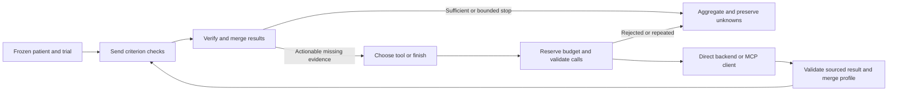

# Class 7: bounded evidence investigation

The existing Class 6 assessment remains deterministic unless a narrative
interpreter is explicitly supplied. Class 7 adds a separate evidence-investigation
graph; it does not turn every extraction or assessment node into an agent.
Claude chooses an evidence lookup, application code validates it, and the existing
criterion engine reassesses the sourced result. A tool cannot approve enrollment.

## Code and flow

| File | Responsibility |
|---|---|
| `src/clinical_trial_patient_matching/patient_tools.py` | Strict input/result schemas, authorized scope, fixed cutoff, parameterized SQLite reads |
| `src/clinical_trial_patient_matching/evidence_agent.py` | LangGraph routing, parallel checks, tool validation, cache and budgets; optional Claude planner |
| `src/clinical_trial_patient_matching/patient_mcp_server.py` | MCP SDK 2.x read-only stdio wrapper over the same backend |
| `src/clinical_trial_patient_matching/patient_mcp_client.py` | SDK discovery, stdio tool execution, error and result normalization |
| `scripts/prepare_class7.py` | Public synthetic scenarios, direct/MCP equivalence and optional small live demo |
| `tests/test_class7.py` | Synthetic adversarial and integration checks |



Independent criterion checks use `Send`, an explicit reducer keyed by
`(round, patient_id, criterion_id)`, and at most four concurrent checks in the
runner. Each has a five-second assessment timeout. Failed/timed-out checks emit
an explicit unknown result with failed processing instead of disappearing.
Each round reads one frozen profile; only validated tool execution creates the
next profile version. Aggregation requires an entry for every expected criterion.

The observation mapping currently covers BMI (`39156-5`) and HbA1c (`4548-4`).
Other missing criteria remain unknown with follow-up; the demo does not claim
arbitrary clinical concept mapping or integrate MIMIC BigQuery into this backend.
The graph currently uses calendar-time public FHIR profiles, not shifted MIMIC
time. No changes were made to existing MIMIC profiles or screening reports.

## Tool contract and limits

Tools: `get_trial`, `search_patients`, `get_patient_record`, and
`get_patient_observations`. Every result has `status`, `rows`, `source_version`,
`coverage`, and an optional error. Status is `ok`, `not_found`, `truncated`, or
`error`; incomplete results never supply a decisive recovered observation.

Authorization is backend-enforced: patient/trial allowlists, an aware fixed
assessment cutoff, and clinical/availability timestamps through that cutoff.
The runtime database connection is `mode=ro` with `query_only=ON`; query values
are parameters. Database hashes bind both configuration and cached results to
the snapshot. Tool annotations only advertise read-only behavior; the backend
implements it. Preparing the local snapshot is a separate explicit write step.

Limits are at most two additional evidence rounds, four reserved tool attempts
per patient, three planner calls, and a shared run-wide tool budget. A whole
multi-call batch must fit before any call is dispatched. Rejected oversized
proposals are counted separately as proposed calls; zero backend calls occur.
Invalid arguments inside an accepted batch still consume reserved attempts.
Identical requests include normalized arguments and source version in the cache
key, and repeated requests in a patient investigation stop rather than loop.
The runner sets graph recursion limit 64. Claude's planner uses at most 800 output
tokens, a 45-second provider timeout, and no automatic provider retries.

Tool-result messages preserve the model's call ID, including explicit rejection
results. Record text remains untrusted data. The optional planner receives only
the missing predicates, patient ID, code, fixed cutoff and tool definitions.
The backend supplies values; existing rules compare them. Sufficient evidence
does not trigger a planner call, and an empty lookup stops with a specific request
for a dated observation.

## Run and inspect

The public inputs must already exist from Class 6: `data/class6/` contains the
shared Synthea profile and frozen NCT03926806 trial. No private datasets are needed.

```bash
pixi install --locked
pixi run class7-demo --output data/class7/offline-run
# Optional, explicitly paid; use a fresh output folder.
pixi run class7-demo --output data/class7/live-run --live
pixi run test
```

The completed live comparison is saved locally at
`data/class7/demo-v2/comparison.md`. Each scenario has a read-only SQLite snapshot,
a scope configuration, fixed/direct/MCP reports, source-linked action logs,
message/call IDs, stop reasons and token usage. Source data and raw responses stay
in ignored `data/` folders. Offline planner fixtures are labelled as fixtures,
not live model results. MCP transport opens a local stdio session per request;
the comparison includes that process-startup cost.

For interactive MCP Inspector discovery (optional GUI), configure the same scope:

```bash
export PATIENT_EVIDENCE_CONFIG="$PWD/data/class7/demo-v2/recoverable/evidence.json"
pixi run mcp dev src/clinical_trial_patient_matching/patient_mcp_server.py
```

The automated demo and tests use the actual SDK stdio client for discovery and
calls, without depending on the graphical Inspector. The installed and locked
SDK version is **2.3.0**. Clients use the v2 `is_error` and `structured_content`
result fields, preserving backend errors and truncation.

## Results and limits

| Scenario | Fixed BMI | Agent BMI | Observation reads | Meaning |
|---|---|---|---:|---|
| Sufficient evidence | met | met | 0 | No unnecessary lookup or planner call |
| BMI withheld initially | unknown | met | 1 | Retrieves BMI 29.38 kg/m2 from the frozen record |
| BMI absent in source | unknown | unknown | 1 | Specific follow-up; no invented value |
| Fictional conflicting BMI | unknown | unknown | 1 | Conflict remains visible; repeated lookup rejected |

The source observation is `e735114d-c4f1-af47-ca8f-6450697f5110`, measured
2021-01-13 at 23:22:51-05:00. The cutoff is 2021-01-13T23:59:59-05:00.
The full trial is retained; resolving BMI does not resolve all other criteria.
The conflicting scenario is explicitly counterfactual and never changes the
downloaded public file.

Direct and MCP results were equivalent for all four cases. The small live run
made **two paid Claude planner calls**, using **2,688 input / 324 output tokens**;
the sufficient-evidence case made none. One live lookup recovered BMI, and one
confirmed it was unavailable in the absent-data fixture. Monetary cost is not
asserted without supplied/verified rates; provider billing is authoritative.
Offline runs use no model tokens. These are engineering integration results,
not clinical accuracy measurements or evidence of general agent reliability.

## References

- [Class 7 requirements](../../class_material/class7.md)
- [LangGraph Graph API and Send](https://docs.langchain.com/oss/python/langgraph/graph-api)
- [Official MCP Python SDK 2.x](https://py.sdk.modelcontextprotocol.io/)
- [MCP tools specification](https://modelcontextprotocol.io/specification/2025-11-25/server/tools)
